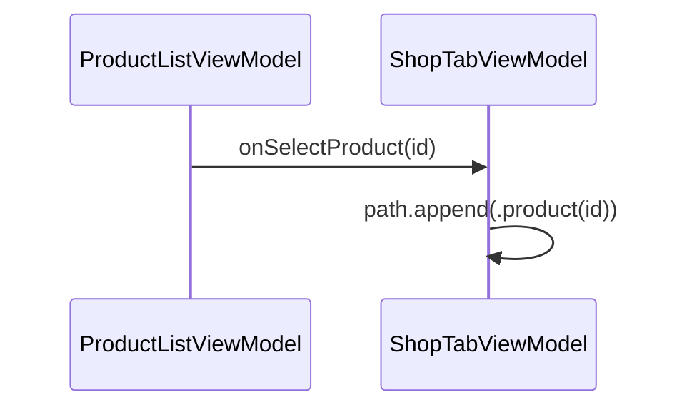

# Reviewable PRs

> **Status: alpha.** The rules are in use on one project. Expect changes.

**A pull request should never overwhelm the human who reviews it.**

Agents write code faster than people can read it. The reviewer's attention is the scarce resource, so every PR is shaped around it: small, about one thing, and described well enough that the reviewer knows where to look and what wasn't checked.

## When this applies

1. **While planning.** Estimate how many files the change will touch. If it's over the budget, plan the split before writing code. Splitting before is cheap; splitting after means rebuilding commits.
2. **Before committing and before opening or updating a PR.** Check the rules below and the checklist at the end.

If the project's own instructions (`AGENTS.md`, `CLAUDE.md` or similar) set a different budget or template, follow the project.

## The rules

### 1. Small enough to review in one sitting

The default budget is **10 files per PR**, not counting generated files: lockfiles, asset catalog JSON, snapshots, generated code. Over budget means split (see "Splitting" below).

### 2. One idea per PR

No drive-by changes. Each of these goes in its own PR, never inside another one:

- Renames, reformatting, moving files.
- Refactors that aren't needed for the change.
- Dependency bumps.
- **Product decisions:** changing a default, renaming something users see, adding or removing a feature. A design or mockup showing it doesn't make it part of the task.

If you notice something worth changing, write it under "Follow-ups" in the description instead of doing it.

### 3. Mechanical changes stand apart

Generated files, mass renames, formatting and translation-file churn go in their own PR or at least their own commit. The description names them as mechanical and says what, if anything, needs a look, so the reviewer can skim them.

### 4. The description does the reviewer's work

Use the template below. The reviewer should know in under a minute what changed, why, how it was checked, and what wasn't.

### 5. No surprises during review

- Say so in a comment when you rebase, force push or otherwise rewrite history under review.
- Don't add new work to a PR that's already under review. Open a follow-up PR.
- When you push changes after a review, comment with what changed since the last review.

## Splitting

Split by idea, in an order where **each PR builds and passes tests on its own**:

- Data or model first, then plumbing, then UI.
- Mechanical changes first, then behavior.
- Each PR's title says its one thing.

How the pieces are published depends on the host. Read [references/hosts.md](references/hosts.md) and find the host with `git remote get-url origin`.

If the work is already written as one big change, rebuild it as a series of commits, one per idea, before publishing. Don't ask the reviewer to untangle it.

## Description template

```markdown
Part 2 of 3. Review after #101. (Only for a split. Link the other parts.)

## What and why
Two or three sentences. The problem, then the change.

## How it was checked
Commands run, tests added, what was tried by hand. Screenshots for UI changes.

## Not done or not verified
Anything skipped, and why. Write "Nothing" if that's true.

## Where to start reviewing
The one or two files that carry the change. Name mechanical files the reviewer can skim.

## Flow (only when the PR changes a flow)
A small diagram. See "Diagrams".

## Follow-ups
Things noticed but deliberately left out.
```

## Diagrams

Add a diagram **only when the PR changes a flow**: navigation, data moving between components, a state machine, a sequence of calls. Skip it for restyles, renames and most bug fixes.

- Use a sequence diagram for interactions and a state diagram for states. Skip class diagrams, which mostly repeat the code.
- Show only what changed, and keep it to about ten boxes. Before and after is fine when that's clearer.
- **Draw it from the code you wrote, not from the plan.** A clean diagram of what you meant to build misleads. Re-read the diff before drawing.
- Write it as a fenced `mermaid` block. Where the host doesn't render Mermaid (see [references/hosts.md](references/hosts.md)), write the flow as a short numbered list instead.



## Checklist before publishing

- [ ] Files changed are within the budget, not counting generated files. If not, split.
- [ ] The PR does one thing. Drive-by changes and product decisions are out.
- [ ] Mechanical changes are separate and labeled.
- [ ] Every section of the description is filled in, including "Not done or not verified".
- [ ] For a split: each part builds and passes tests on its own, and links the others.
- [ ] A diagram is included only if a flow changed, and it matches the code.
